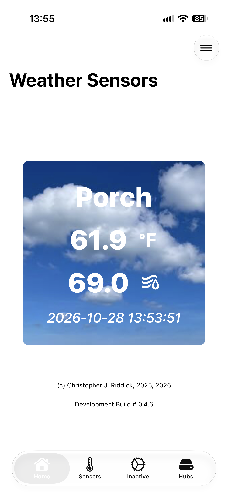
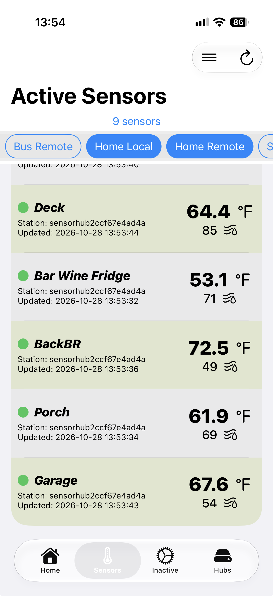
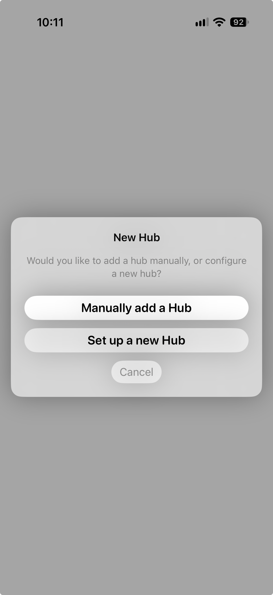
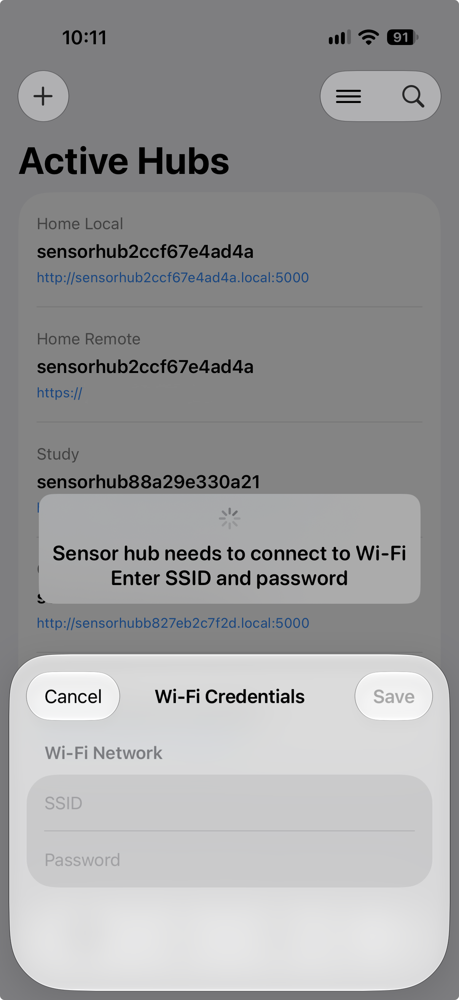
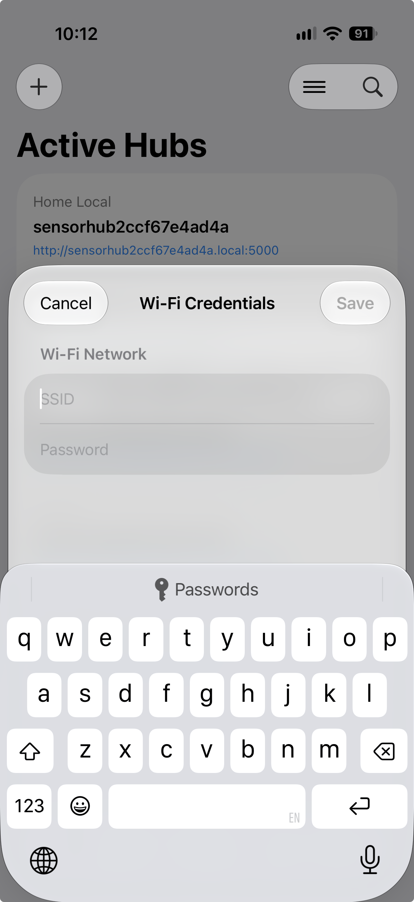
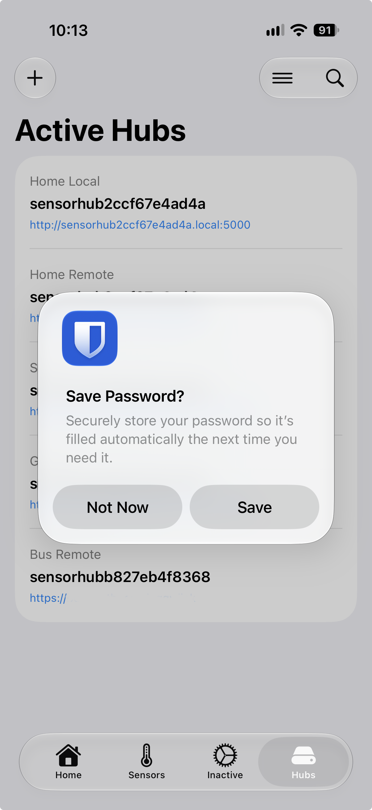
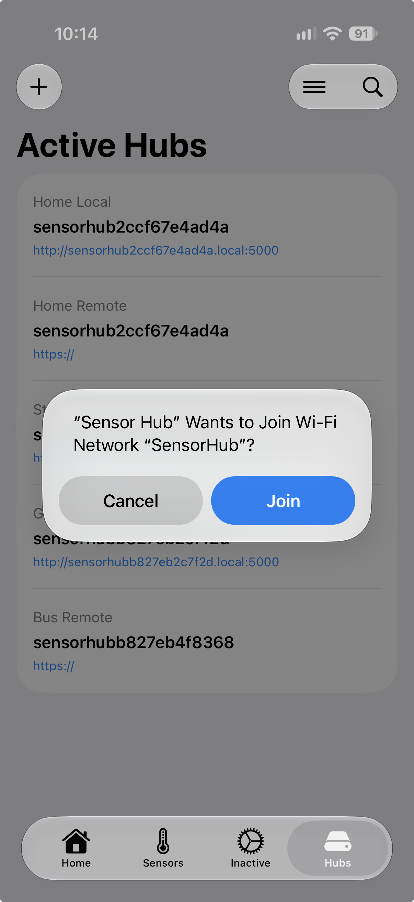
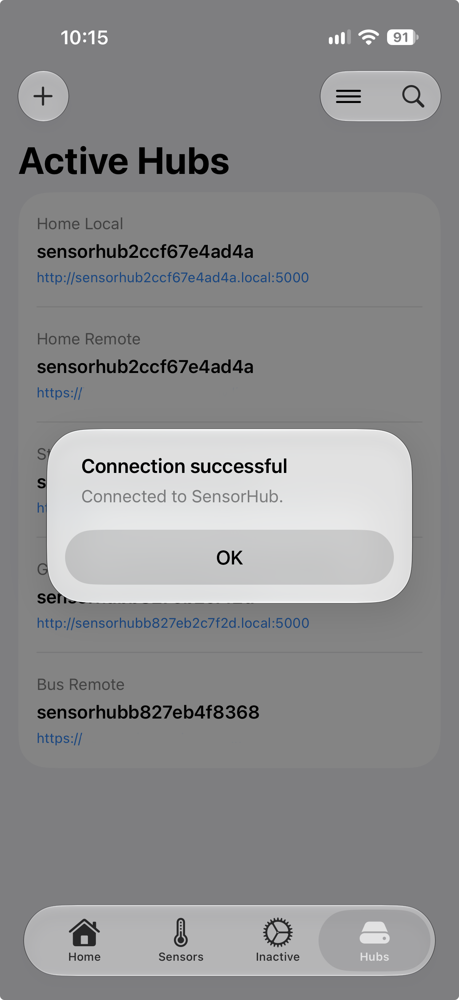
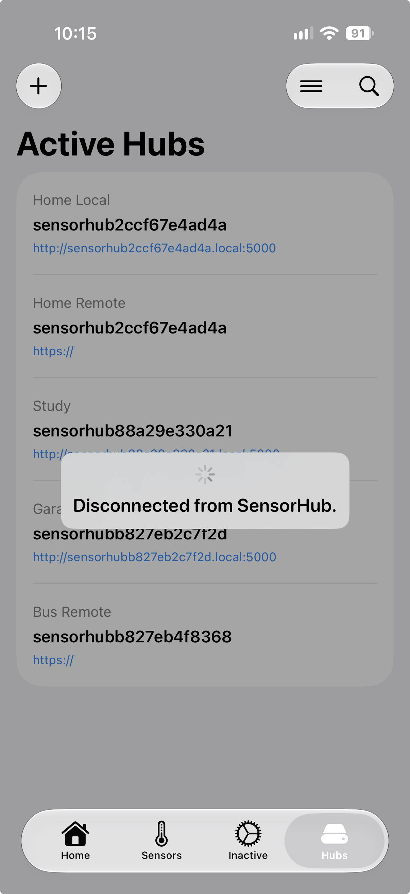
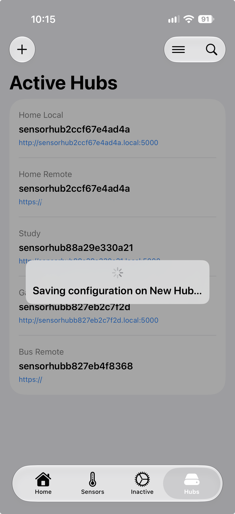

# Sensor Hub
SensorHub is an iPhone/iPad app that is used to configure and monitor multiple Sensor Hubs. This is a companion app to the [sensorhub](https://github.com/cjr29/sensorhub.git) project.

The Sensor Hub app provides access to the sensorhub weather server. Using the app, you can see the temperature and humidity of multiple sensors from multiple sensor hubs. A sensor hub collects data from sensors and makes it available via a REST API which the Sensor Hub app knows how to use. Sensor Hubs broadcast their service using Bonjour. The Sensor Hub app can find and manage sensor hubs on a local network using Bonjour. The Sensor Hub app can also be configured to access remote sensor hubs via services like reverse proxy.

This Xcode project was developed for personal use. Since the Sensor Hub hardware is a "maker" project, not commercially available, it is not practical to try to support this app on the Apple App Store. Therefore, the code is being made available under the Mit License for use by anyone who wants to build a Sensor Hub and have an iOS app to manage it. Sample screen shots are provided below from my implementation of the app. An Apple Developer account is needed to build the app and install on an iPhone or iPad. Perhaps someone will develop and Android version or even a Web-based app to access the Sensor Hub. For now, this is just a hobby project to make use of my weather sensors.

# Sample Screenshots
 
 
 
 
 

# Contributing
Contributions are welcome.
Please open an issue or submit a pull request with a clear description of:
- the problem being solved
- the changes made
- any configuration or compatibility considerations

# Developer Notes
This repository is a public version of the full development repo. That private repo is not made available for reasons of privacy and developer agreements. If anyone wishes to contact me about configuring their own Xcode environment for this, please submit an Issue or Pull Request in this repo.

Some specific requirements are listed below because the app does access devices on a local network. Apple is very restrictive in how apps access local networks. Be sure to add the correct entitlements and plist entries to your Xcode configuration.

## Required entitlements:
- com.apple.developer.networking.HotspotConfiguration
- com.apple.developer.networking.multicast
- com.apple.developer.networking.wifi-info
- com.apple.security.files.user-selected.read-write

## plist:
- NSLocalNetworkUsageDescription, string = Sensor Hub would like local network access to discover sensor hubs on your Wi‑Fi.
- NSAppTransportSecurity
- NSAllowsLocalNetworking
- NSBonjourServices, array: "_sensorhub._tcp"
- CFBundleGetInfoString
- UIBackgroundModes, array: string fetch, string processing
